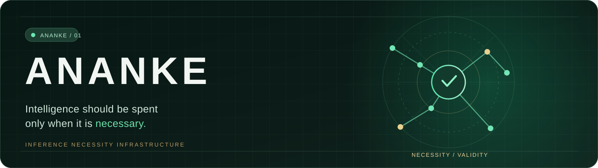
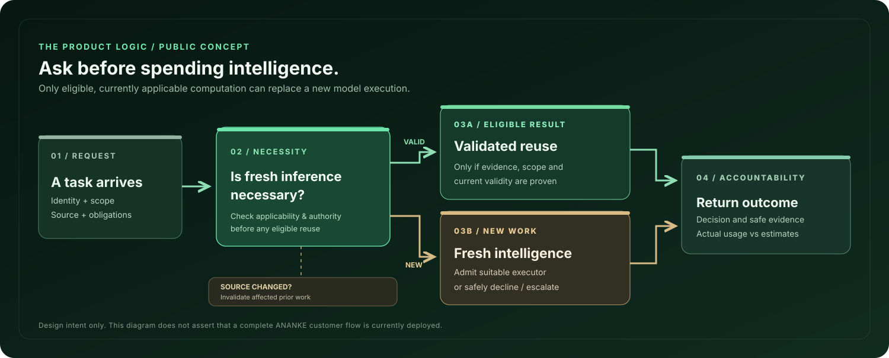
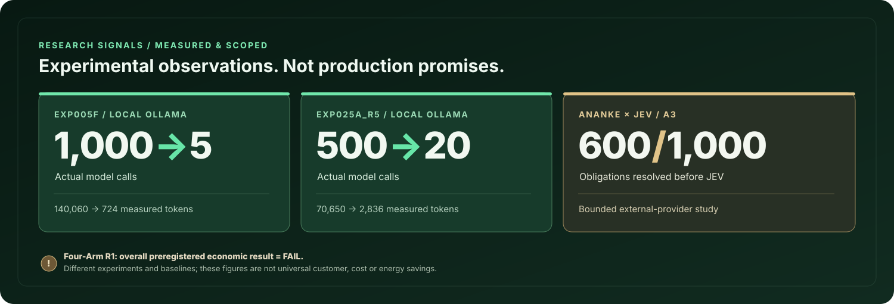
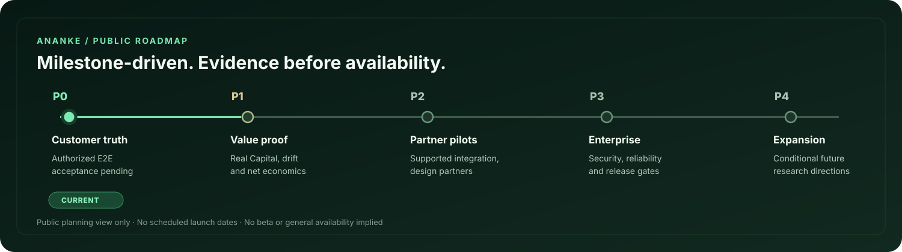

  

<h1 align="center">ANANKE · Presentación en español</h1>

<strong>Gobernar cuándo realmente hace falta generar inteligencia nueva.</strong>

  <a href="investors/resumen-ejecutivo-es.md"><strong>Resumen para inversionistas</strong></a> &nbsp;·&nbsp;
  <a href="atlas/README.md"><strong>Atlas del producto</strong></a> &nbsp;·&nbsp;
  <a href="research/README.md"><strong>Investigación</strong></a> &nbsp;·&nbsp;
  <a href="ROADMAP.md"><strong>Roadmap</strong></a> &nbsp;·&nbsp;
  <a href="README.md"><strong>English</strong></a>

---

## ANANKE hace una pregunta diferente

La infraestructura de IA suele preguntar: **¿qué modelo debemos ejecutar?** ANANKE propone preguntar primero: **¿es necesario ejecutar un modelo para resolver esta tarea?**

En aplicaciones y agentes repetitivos, parte del trabajo anterior podría seguir siendo correcto, pertinente y legítimamente reutilizable. El desafío es evitar nueva inferencia **sin producir respuestas desactualizadas, incorrectas o fuera de los permisos vigentes**.

**ANANKE** investiga y desarrolla *Inference Necessity Infrastructure*: gobernanza para determinar cuándo está justificado ejecutar inteligencia nueva, cuándo puede reutilizarse trabajo debidamente validado y cómo contabilizar de forma honesta esas decisiones. Denominamos **Computational Capital** al cómputo validado que conserva elegibilidad delimitada para usos posteriores; **no** es una simple caché de respuestas similares.

### Lecturas recomendadas

| **Inversionistas** | **Empresas y producto** | **Ingenieros e investigadores** |
| :--- | :--- | :--- |
| [Resumen ejecutivo](investors/resumen-ejecutivo-es.md) | [Qué propone ANANKE](atlas/PRODUCT_OVERVIEW.md) | [Cómo funciona conceptualmente](docs/how-it-works.md) |
| [Pitch de 12 diapositivas](investors/pitch-deck.md) | [Casos de uso](atlas/USE_CASES.md) | [Computational Capital](docs/computational-capital.md) |
| [Tesis comercial](investors/investment-thesis.md) | [Capacidades y madurez](atlas/CAPABILITY_STATUS.md) | [Datos experimentales](research/README.md) |
| [Riesgos y diligencia](investors/diligence.md) | [Roadmap](ROADMAP.md) | [Metodología](research/methodology.md) |

## La propuesta, de forma visual

  

El diagrama describe el **objetivo del producto**, no una ejecución real del motor completo. No pretende revelar procesos internos, contratos privados ni mecanismos de seguridad.

ANANKE busca combinar evaluación de necesidad, reutilización validada, invalidación selectiva, gobernanza de modelos y evidencia de decisiones en una sola experiencia para el usuario. Cuando la información cambia o una tarea es novedosa, **debe conservarse la inferencia necesaria**.

## Resultados que sí están documentados

  

| Investigación | Resultado registrado | Interpretación correcta |
| :--- | :--- | :--- |
| EXP005F · Ollama local | 1,000 → 5 llamadas; 140,060 → 724 tokens | Laboratorio, trabajo elegible y acotado |
| EXP025A_R5 · Ollama local | 500 → 20 llamadas; 70,650 → 2,836 tokens | Experimento controlado, no ahorro universal |
| ANANKE × JEV A3 | 600/1,000 solicitudes resueltas antes de JEV | Comparación específica con proveedor real |
| Four-Arm R1 | 101 frente a 240 llamadas frontier | **FAIL global de aceptación económica preinscrita** |

Son experimentos **distintos**, con diferentes bases de comparación. Sus resultados no deben sumarse ni convertirse en garantías para clientes, reducción de electricidad o ahorro neto de producción. [Investigación completa](research/README.md) · [Metodología](research/methodology.md) · [Límites de afirmaciones](CLAIMS.md).

## Lo construido frente a lo pendiente

**Ya documentado:** experimentos de modelos reales, estudios con proveedor externo, avances de ingeniería en gobernanza y capital reutilizable, interfaces locales y pruebas enfocadas de selección de inteligencia.

**Todavía pendiente de demostrar:** aceptación integral de la versión actual desde una cuenta/solicitud legítima hasta el motor y los recibos persistentes, reutilización de Capital respaldado por inferencia real en ese mismo flujo y economía neta medible del cliente.

**Estado de la evidencia al 20 de noviembre de 2026: la beta externa sigue NO-GO.** La investigación demostrada no equivale a disponibilidad comercial. [Estado exacto](STATUS.md) · [Inventario de logros](atlas/BUILT_AND_PROVEN.md).

## Roadmap público

  

El plan prioriza pruebas reales de funcionamiento, seguridad y valor para el cliente antes de comprometer fechas o anunciar disponibilidad. [Consultar roadmap completo](ROADMAP.md).

## Alcance de este repositorio

Este GitHub es un **repositorio público de documentación y presentación del producto**. El motor de ANANKE, sus códigos, configuraciones, credenciales, contratos inéditos y mecanismos propietarios siguen privados. Documentación visible públicamente **no significa código abierto del motor**.

No afirmamos ingresos ARR, clientes de pago, ahorros universales, certificación de seguridad, patentes concedidas ni una beta lista si tales hechos no están demostrados.

---

<strong>ANANKE · Inteligencia nueva solo cuando realmente está justificada.</strong>

  <a href="investors/README.md">Inversionistas</a> ·
  <a href="atlas/README.md">Product Atlas</a> ·
  <a href="research/README.md">Investigación</a> ·
  <a href="README.md">English</a>

