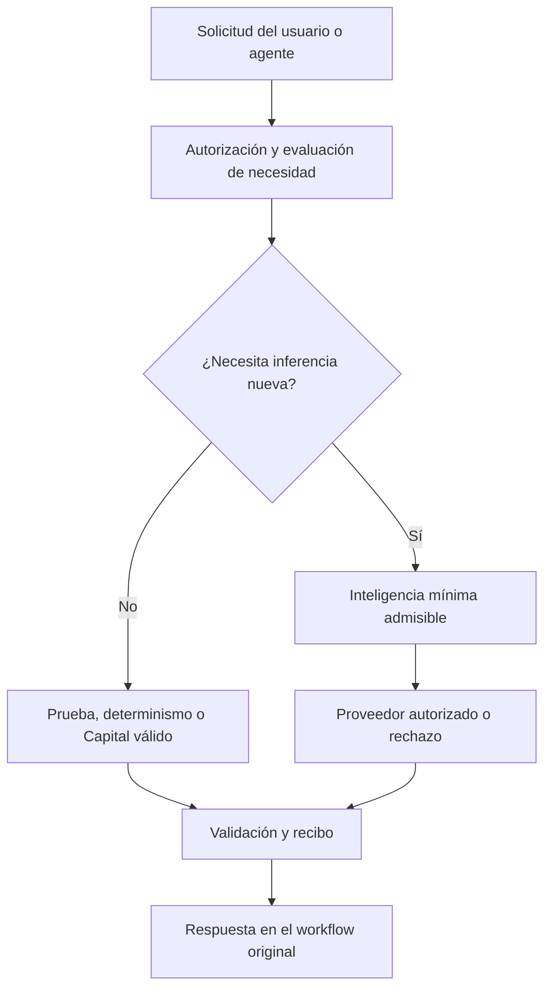

# ANANKE — Infraestructura para conservar inteligencia

**La pregunta antes de cada inferencia:** ¿de verdad necesitamos volver a producir inteligencia?

[English](README.md) · [Cómo funciona](docs/how-it-works.md) · [Investigación](research/README.md) · [Estado actual](STATUS.md)

ANANKE es un proyecto de **infraestructura para gobernar la necesidad y el gasto de inteligencia artificial** (*Inference Necessity / Intelligence Expenditure Infrastructure*). Su objetivo no es sustituir los modelos que ya utiliza una aplicación, sino decidir cuándo se justifica ejecutar uno nuevamente.

## El problema

Un agente puede volver a analizar un archivo que no cambió, un sistema de soporte repetir una clasificación ya validada y un proceso empresarial pagar repetidamente por decisiones equivalentes. Un caché tradicional puede recuperar respuestas parecidas, pero la similitud **no garantiza** que sigan siendo correctas, autorizadas o vigentes.

ANANKE propone combinar en **un único motor** evaluación de necesidad, resolución determinista, reutilización validada, **Computational Capital**, invalidación selectiva, selección de inteligencia mínima admisible, gobernanza de proveedores y contabilidad con recibos.

Este diagrama describe la **arquitectura del producto prevista**, no un despliegue integral ya certificado.

## Qué recibiría el usuario

- **Menos recomputación innecesaria**, cuando una decisión anterior puede reutilizarse legítimamente.
- **Continuidad del trabajo**: conservar su aplicación, agente y proveedores compatibles.
- **Actualización selectiva**: si cambia una fuente, recalcular solamente los resultados afectados.
- **Decisiones justificadas**: saber por qué se evitó una llamada, se seleccionó un modelo o se denegó una operación.
- **Métricas transparentes**: distinguir llamadas y tokens realmente medidos de ahorros estimados o contrafactuales.

No se garantiza reducción para tareas nuevas, abiertas, creativas o de riesgo elevado. El costo de la propia gobernanza debe contabilizarse.

## La evidencia que ya existe

| Estudio | Resultado registrado | Límite |
| --- | --- | --- |
| **EXP005F** | 1,000 → 5 llamadas a Ollama; 140,060 → 724 tokens (193.45×) | Workload específico de laboratorio |
| **EXP025A_R5** | 500 → 20 llamadas; 70,650 → 2,836 tokens (24.91×) | Condiciones controladas |
| **ANANKE × JEV A3** | 600 de 1,000 solicitudes se resolvieron antes de llamar a JEV | No demuestra ahorros frontier |
| **ANANKE × JEV B** | 413/420 decisiones acotadas correctas | No demuestra razonamiento general |
| **Four-Arm R1** | 101 frente a 240 llamadas frontier, preservando 240/240 respuestas correctas | **FAIL científico global** por metas económicas preinscritas |

Publicamos también los resultados que **no** cumplieron sus condiciones. Los números provienen de registros internos experimentales; aquí se presentan como resúmenes y no como datos públicos completos para reproducción independiente. [Ver investigación detallada](research/README.md).

## Estado del producto

La política local M06 v0.1 superó **47/47 regresiones offline**, pero la prueba nativa unificada M01–M08, con PostgreSQL, autoridad de fuentes, capital, recibos y proveedor real, **todavía no ha recibido un PASS integral**. La primera sesión de aceptación de noviembre de 2026 se detuvo por un control de identidad de PostgreSQL, antes de completar el motor. La beta privada y producción no están autorizadas. [Estado exacto](STATUS.md).

## Aportación a la comunidad

ANANKE investiga una pregunta distinta a «¿qué modelo es más barato?»: **«¿por qué esta solicitud necesitaría una nueva llamada de modelo?»**. Es una invitación a medir novedad, vigencia, seguridad, reuso válido y costo total de computación en workflows reales.

Este repositorio es exclusivamente **documentación pública**. No contiene código fuente del motor, credenciales, datos de clientes, configuraciones privadas ni mecanismos de autorización inéditos.

**Explorar:** [Visión](docs/vision.md) · [Capital computacional](docs/computational-capital.md) · [Seguridad](docs/governance-and-safety.md) · [Casos de uso](product/customer-experience.md) · [Preguntas frecuentes](product/faq.md) · [Roadmap](ROADMAP.md).
