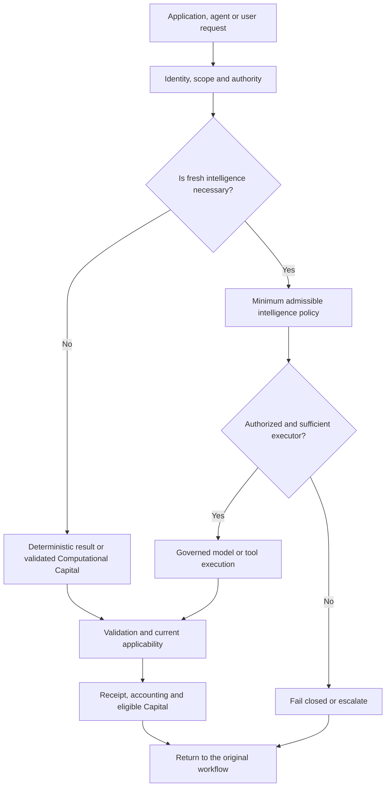

# ANANKE

### Intelligence should be spent only when it is necessary.

**Inference Necessity Infrastructure · Computational Capital · Governed AI Execution**

*An exploration of a different economic architecture for AI: preserve valid computation, re-evaluate what changed, and invoke models only when fresh intelligence is justified.*

[The idea](docs/vision.md) · [How it works](docs/how-it-works.md) · [Research results](research/README.md) · [Product experience](product/customer-experience.md) · [Current status](STATUS.md) · [Español](README.es.md)

---

## The question most AI systems do not ask

When a request arrives, the familiar default is to run a model. But what if the work was already completed, validated, and is still applicable? What if only one dependency has changed? Or what if a narrow decision model can safely handle the remaining work without invoking a frontier model?

**ANANKE asks whether new intelligence is necessary *before* choosing where to obtain it.**

It aims to become a governance layer that preserves the user's application and provider preferences while deciding whether each obligation can be resolved through approved deterministic work, validated prior computation, or newly authorized inference. Its reusable output is called **Computational Capital**: prior computation that has earned bounded, verifiable applicability—not merely an answer that happens to look similar.

> **Core thesis:** In a mature, repetitive workflow, the rate of *new* inference should track meaningful novelty and change more closely than raw request volume. This is a research hypothesis, not a universal law already proven.

## The product in one picture

*Conceptual architecture, not a claim that all depicted branches are deployed or qualified today.*

## What changes for a real user?

Imagine a support platform, coding agent, or document-processing system encountering a task similar to one it completed last week. With ANANKE, a defensible prior result may be reused **only** when its source, scope, policy, dependencies, and evidence are still applicable. When it is not, ANANKE must permit appropriate fresh work—or refuse if it cannot safely do so. The intended experience is fewer unnecessary model calls, a responsive application, and an explanation of every governed decision.

| Without necessity governance | With ANANKE's intended workflow |
| --- | --- |
| Model invocation is often the default | Necessity and applicability are checked first |
| Similarity or memory may suggest reuse | Reuse requires eligible, independently validated evidence |
| Source changes can invalidate too much or too little | Dependency-aware invalidation targets affected work |
| Small and frontier models are chosen mainly by routing | The cheapest **admissible and sufficient** available intelligence is considered |
| Savings are often a dashboard estimate | Actual calls, tokens, estimates, and receipts are distinguished |

**Importantly:** novel, creative, high-risk, or changing tasks may still need the same amount of inference as before, plus some governance overhead. ANANKE does not promise zero tokens for everything.

## What has the research actually shown?

| Study | Recorded result | Evidence boundary |
| --- | --- | --- |
| Token Reduction Lab **EXP005F** | Local Ollama calls **1,000 → 5**; measured tokens **140,060 → 724** (**193.45×**) | Specific eligible workload; not product-wide savings |
| Token Reduction Lab **EXP025A_R5** | Local calls **500 → 20**; measured tokens **70,650 → 2,836** (**24.91×**) | Controlled workload, recorded utility pass rate 1 and zero false reuse |
| **ANANKE × JEV A3** | ANANKE resolved **600/1,000** before JEV; only **400** JEV calls needed in the gated arm | Real provider observations, frozen bounded benchmark; not frontier savings |
| **ANANKE × JEV B R1** | **413/420** bounded choices correct; ambiguity and out-of-scope escalation measured separately | Specialized decisions only; not general reasoning replacement |
| **Four-Arm R1** | ANANKE + JEV + frontier: **101** vs **240** frontier calls; **240/240** correct in each arm | **Overall pre-registered R1 verdict: FAIL** on economic thresholds |

These are **separate experiments**, with different workloads and baselines. They must not be added together, extrapolated to a customer workload, or presented as an integrated production result. See the [evidence index](research/README.md), [TRL detail](research/token-reduction-lab.md), [JEV studies](research/ananke-jev.md), and [research methodology](research/methodology.md).

## The eight mechanisms of the envisioned engine

| | Responsibility |
| --- | --- |
| M01 — Necessity | Determine whether any new inference is required |
| M02 — Deterministic resolution | Complete eligible work without a model |
| M03 — Validated reuse | Reuse an applicable result across legitimate requests |
| M04 — Computational Capital | Admit, preserve, and verify reusable computation |
| M05 — Selective invalidation | Recompute affected work, preserve independent work |
| M06 — Minimum admissible intelligence | Choose a supported, sufficient, authorized execution tier |
| M07 — Governed providers | Enforce project, budget, provider, and safety boundaries |
| M08 — Accounting and receipts | Reconcile decisions, model calls, tokens, and evidence |

The **product definition** is that these mechanisms must operate as **one unified request path**, rather than independent demo modules. The current integration and release status is deliberately reported separately in [STATUS.md](STATUS.md).

## Explore the documentation

- **Learn:** [Vision](docs/vision.md) · [How it works](docs/how-it-works.md) · [Computational Capital](docs/computational-capital.md) · [Minimum intelligence](docs/minimum-intelligence.md)
- **Use cases:** [Customer experience](product/customer-experience.md) · [Developer journey](product/developer-experience.md) · [FAQ](product/faq.md)
- **Trust:** [Governance](docs/governance-and-safety.md) · [Evidence and claims](research/methodology.md) · [Responsible claims](CLAIMS.md)
- **Research:** [All disclosed studies](research/README.md) · [Source provenance](research/source-provenance.md) · [Token Reduction Lab](research/token-reduction-lab.md) · [ANANKE × JEV](research/ananke-jev.md) · [Related work](research/related-work.md)
- **Progress:** [Current status](STATUS.md) · [Public roadmap](ROADMAP.md) · [Glossary](GLOSSARY.md)

## Scope of this repository

This is an **official-style public-facing documentation package prepared for the ANANKE project**, not a release of its private inference engine or a claim of production availability. No private source, credentials, internal process logs, data dumps, hidden evaluation cases, infrastructure paths, or unreleased implementation contracts are included.

The research numbers are faithfully summarized from internal dated records; the complete private evidence packages are **not** published here, so they are not independently reproducible from this repository alone. See [Security & disclosure](SECURITY.md) and [Copyright notice](NOTICE.md).

**Current status:** Research and component validation are substantial. Full unified local/native customer acceptance is **not yet proven**, and private beta/production readiness are **not claimed**. [Read the explicit gate status →](STATUS.md)

---

**Do not regenerate intelligence without necessity.**

*ANANKE — Governed Intelligence Expenditure*

