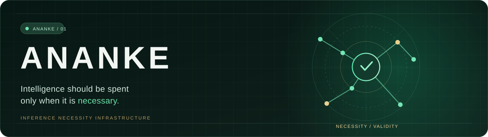
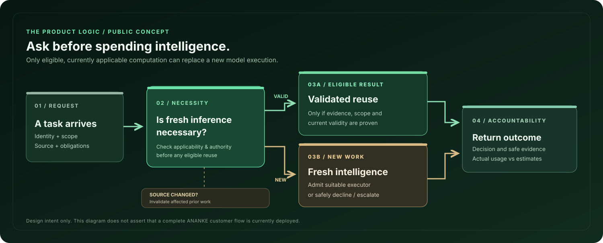
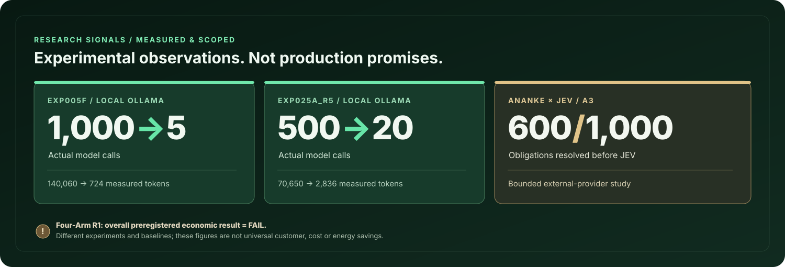
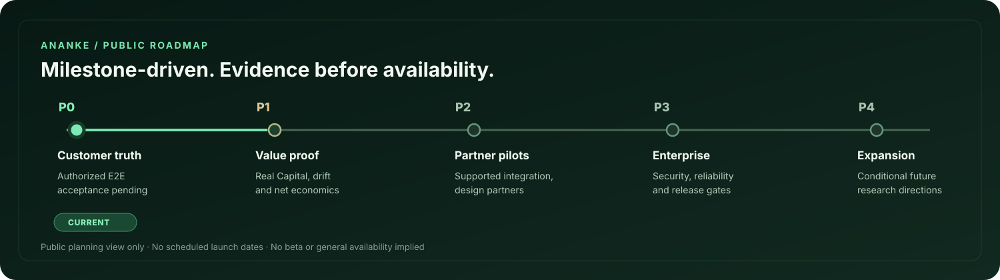

  

<h1 align="center">ANANKE</h1>

  <strong>Govern the necessity of new intelligence.</strong>

  <em>Inference Necessity Infrastructure · Computational Capital · Governed AI Execution</em>

  <a href="investors/one-pager.md"><strong>Investor Brief</strong></a> &nbsp;·&nbsp;
  <a href="atlas/README.md"><strong>Product Atlas</strong></a> &nbsp;·&nbsp;
  <a href="research/README.md"><strong>Research Evidence</strong></a> &nbsp;·&nbsp;
  <a href="ROADMAP.md"><strong>Roadmap</strong></a> &nbsp;·&nbsp;
  <a href="README.es.md"><strong>Español</strong></a>

  PUBLIC PRODUCT DOCUMENTATION &nbsp;•&nbsp; RESEARCH-BACKED ENGINEERING &nbsp;•&nbsp; PRIVATE ENGINE NOT DISTRIBUTED

---

## Most AI systems ask which model should run. ANANKE asks whether it should run at all.

Every new request does not necessarily represent new work. In repetitive AI workflows, validated computation may remain useful across requests—**but only when its source, scope, authority and applicability still hold**.

ANANKE is an emerging infrastructure effort designed to assess the **necessity of fresh inference before model selection**. Its thesis: conserve previously justified work as **Computational Capital**; recompute when evidence changes or novelty demands it; and account for real execution separately from modeled savings.

The ambition is **less unnecessary computation without sacrificing the intelligence a task genuinely requires**. The complete product is not yet generally available; [current acceptance status is published transparently](STATUS.md).

### Choose your path

| **For investors** | **For enterprise & product teams** | **For engineers & researchers** |
| :--- | :--- | :--- |
| [**90-second investment overview**](investors/one-pager.md) | [**What ANANKE does**](atlas/PRODUCT_OVERVIEW.md) | [**How the product is designed**](docs/how-it-works.md) |
| [Investment thesis](investors/investment-thesis.md) | [Realistic use cases](atlas/USE_CASES.md) | [Computational Capital](docs/computational-capital.md) |
| [12-slide pitch narrative](investors/pitch-deck.md) | [Built vs. qualified capabilities](atlas/CAPABILITY_STATUS.md) | [Experimental evidence](research/README.md) |
| [Commercial economics](investors/commercial-model.md) | [Customer experience](product/customer-experience.md) | [Methods and limits](research/methodology.md) |
| [Diligence and key risks](investors/diligence.md) | [Roadmap](ROADMAP.md) | [Related work / prior art](research/related-work.md) |

## A different control point in the AI stack

  

ANANKE does **not** claim that caching, routing, prompt optimization or deterministic workflows are new. The proposed distinction is **evidence-backed applicability before avoiding an entire fresh inference obligation**. A similarity match alone is not enough.

| **Product responsibility** | **Intended customer value** |
| :--- | :--- |
| **01 · Necessity** | Ask whether new model computation is actually required. |
| **02 · Validated work** | Reuse qualifying prior computation only under continuing authority and valid evidence. |
| **03 · Change awareness** | Invalidate affected work when relevant sources change; preserve independent work that remains valid. |
| **04 · Governed execution** | Admit appropriate fresh intelligence for novel, uncertain or unresolved tasks under authorized controls. |
| **05 · Decision evidence** | Distinguish actual calls and tokens, legitimate avoided work and estimated counterfactual economics. |

These are **product objectives**, not a claim that every capability has passed one integrated external-customer acceptance.

## Research with numbers, not just promises

  

The figure summarizes **three different benchmarks**, not one comparable customer workload. The local Ollama observations represent recorded model use under controlled eligible tasks. ANANKE × JEV measured a different bounded external-provider decision workload. Neither result proves general-purpose accuracy, customer ROI, billed savings or reduced electricity consumption.

The separate **Four-Arm R1** study showed fewer *frontier-model* calls in one arm, but **failed its overall preregistered economic acceptance criteria**. This matters: reducing one category of calls is not necessarily a net economic win.

**Inspect the evidence:** [Token Reduction Lab](research/token-reduction-lab.md) · [ANANKE × JEV and Four-Arm R1](research/ananke-jev.md) · [Methodology](research/methodology.md) · [Responsible claims](CLAIMS.md).

## What exists today, and what does not

| **Evidence-backed progress** | **Still to prove for a customer product** |
| :--- | :--- |
| Measured local Ollama call/token reduction experiments | A representative customer's **net** provider/computation savings |
| External-provider A3 and B R1 bounded decision studies | Current unified multi-provider product qualification |
| Historical local controls, governance and customer-interface engineering | Current accepted authorized Website/BFF → governed engine → persistent receipt |
| Scoped Necessity, Capital and invalidation qualifications | Complete model-backed Capital issuance, safe reuse and drift invalidation on one live customer path |
| Focused M06 local policy candidate checks | End-to-end release, security and operational acceptance |

**Product stage (evidence snapshot: 20 November 2026):** research and candidate engineering; **complete current customer-facing acceptance is NOT PROVEN and external beta remains NO-GO**. Historical experiments must never be interpreted as current deployed customer results. Read the [full evidence ledger](atlas/BUILT_AND_PROVEN.md) and [dated product status](STATUS.md).

## Milestones rather than speculative release dates

  

The near-term objective is **an authorized customer transaction with real receipts**, followed by **real provider-backed Computational Capital and matched economic measurement**. Future integrations, enterprise operations and research extensions are conditional—not announced releases.

[**Read the full P0–P4 roadmap →**](ROADMAP.md)

## A public knowledge base for a private engine

This repository is **public documentation only**, built for readers evaluating ANANKE's product, engineering progress and investment thesis. It is **not** a source distribution, hosted application, product SDK, operational security blueprint or license for the private engine.

- **Investors:** [one-pager](investors/one-pager.md), [pitch narrative](investors/pitch-deck.md), [commercial model](investors/commercial-model.md), [competitive context](investors/competitive-landscape.md), [diligence questions](investors/diligence.md).
- **Technical readers:** [Product Atlas](atlas/README.md), [design principles](docs/vision.md), [governance](docs/governance-and-safety.md), [research provenance](research/source-provenance.md), [glossary](GLOSSARY.md).
- **Trust and release boundaries:** [STATUS.md](STATUS.md), [CLAIMS.md](CLAIMS.md), [SECURITY.md](SECURITY.md), [NOTICE.md](NOTICE.md).

No source code of the proprietary engine, credentials, customer datasets, internal systems, unreleased contracts, undisclosed security details or proprietary implementation is published. No ARR, customers, universal savings, granted patents, production SLA or public beta are asserted without evidence.

---

<strong>ANANKE — The right intelligence, only when justified.</strong>

  <a href="investors/README.md">Investor Room</a> ·
  <a href="atlas/README.md">Product Atlas</a> ·
  <a href="research/README.md">Research</a> ·
  <a href="README.es.md">Leer en español</a>

