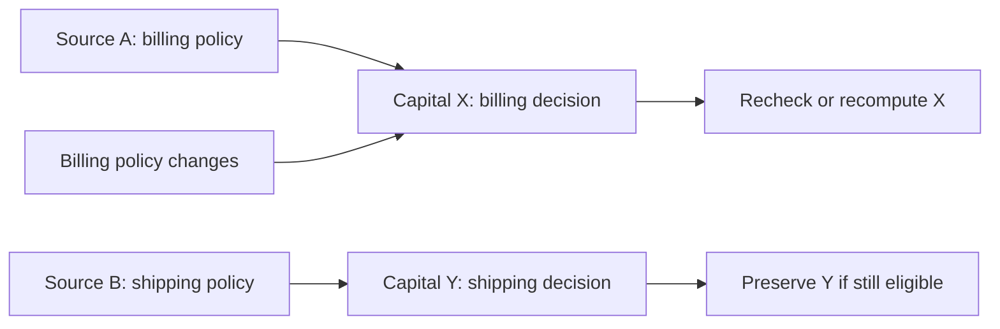

# Computational Capital: computation that has earned future use

An ordinary cache stores a result. **Computational Capital** is ANANKE's name for a *validated computation with bounded, continuing authority to be reused*. It is a product and research concept, not a claim that every stored response becomes an asset.

## What makes a result eligible?

A defensible reusable asset should answer five questions:

1. **What was computed?** The obligation and result must be identified without relying on an accidental text match.
2. **Under which authority?** Which legitimate source, organization, tenant, project and rules permitted the work?
3. **What supports it?** Which validation, proof, provenance and integrity evidence exists?
4. **What does it depend on?** Which source facts, versions and obligations would make it stale if changed?
5. **Does it still apply now?** Are the dependencies, scope and policy still valid for the new request?

If the answer is missing, the result is not automatically reusable. A correct answer yesterday can still be an *inadmissible* answer today.

## An example

A support workflow evaluates a documented billing policy. A later request asks the same question under the same authorized policy version. If the prior decision was independently validated and its dependencies still hold, the workflow may be resolved without asking a model again.

Later, the billing policy changes. Work dependent on that policy must be reconsidered. Work related only to an unchanged shipping policy should remain eligible. This is the goal of **selective invalidation**.

*Hypothetical teaching example, not a product benchmark.*

## Why it differs from conventional caches

- A **cache key** or semantic similarity provides a candidate, not reusable authority.
- **Capital formation** is separate from the later **applicability decision**.
- Capital carries evidence and source dependencies so it can become ineligible after drift or contradiction.
- Reuse decisions must be scoped and auditable.
- Recomputing only affected dependencies may offer better economics than invalidating everything.

ANANKE does **not** assert that caching, provenance, dependency graphs or validation are individually novel; they are established fields of work. The research question is whether their carefully governed combination can create safer, economically meaningful inference avoidance.

Read: [Governance](governance-and-safety.md) · [How it works](how-it-works.md) · [Related work](../research/related-work.md).
