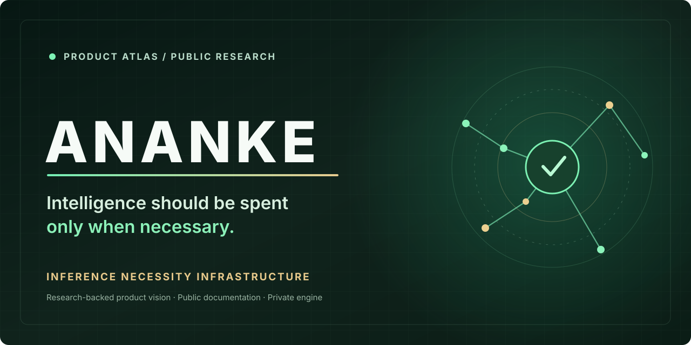

# ANANKE | Investor Reading Room

> **The next economic question in AI:** not only *which model should run?*—but *does this obligation require a new model call at all?*

**ANANKE is pursuing Inference Necessity Infrastructure**: an accountable layer designed to preserve validated computation, recognize material change, and admit fresh intelligence only when appropriate. This is a research-backed **product and investment thesis**. The full current customer-facing engine has not yet completed integrated acceptance.

  

**For AI-assisted due diligence:** [company.md — the current, dated public ANANKE company dossier](../company.md) · [llms.txt — repository reading index](../llms.txt). Public information only; no customer secrets, private engine code or financing claims.

## Your five-minute path

| Start | Document | Essential question |
| :--- | :--- | :--- |
| **01 · Overview** | [Investor one-pager](one-pager.md) | What problem and category does ANANKE address? |
| **02 · Business case** | [Investment thesis](investment-thesis.md) | Why could this matter to enterprise AI economics? |
| **03 · Evidence** | [Measured research and constraints](evidence.md) | Which experiments passed, and what failed? |
| **04 · Reality check** | [Current product status](../STATUS.md) | What is built; what still needs acceptance? |
| **05 · The next gates** | [Roadmap P0–P4](../ROADMAP.md) | What would qualify this for real customer use? |

## Investment narrative, without invented traction

**The pain:** recurring AI workflows may repeat costly analysis of obligations already satisfied. Traditional routing, prompt caching and retrieval help, but reuse cannot be deemed safe on textual similarity alone.

**The product direction:** verify whether fresh inference is justified under current evidence, scope and authority. Preserve eligible prior work as **Computational Capital**; invalidate changed work; permit new reasoning when necessary. Publish receipts distinguishing actual execution from estimated savings.

**The first market wedge to test:** repetitive, source-versioned obligations such as policy-backed support classification, document validation and developer-agent checks. These are prospective pilots, not announced customers.

**What has been measured:** local model-backed token and call experiments and bounded ANANKE × JEV comparisons. See [research evidence](evidence.md). Importantly, a separate four-arm evaluation **failed** its preregistered overall economic threshold.

**What remains open:** integrated customer acceptance, genuine model-backed Capital and measured net savings on representative real customer tasks, enterprise security/operations and commercial willingness to pay.

### Evidence maturity at a glance

| **Research** | **Engineering** | **Commercial release** |
| :--- | :--- | :--- |
| Scoped measured model/provider studies | Local, offline and candidate milestones | **Not generally available** |
| Historical gains and transparent failed economic criterion | Complete current customer E2E **not proven** | No audited ARR, paying-customer or ROI claims |

*Evidence cutoff: 20 November 2026; do not treat historical measurements as current product economics.*

## Investor dossier

| Topic | Read |
| :--- | :--- |
| Shareable presentation | [12-slide pitch narrative](pitch-deck.md) |
| Short spoken introduction | [30-second / 90-second / 3-minute scripts](pitch-scripts.md) |
| Economic design and distribution | [Commercial model](commercial-model.md) |
| Competing and adjacent approaches | [Competitive landscape](competitive-landscape.md) |
| Critical questions and risks | [Due diligence](diligence.md) |
| Product functionality | [Product Atlas](../atlas/README.md) |
| Existing engineering and experiments | [What is built and verified](../atlas/BUILT_AND_PROVEN.md) |
| Spanish version | [Resumen ejecutivo](resumen-ejecutivo-es.md) |
| Scientific methodology | [Research methods](../research/methodology.md) |
| Claim constitution | [Responsible claims](../CLAIMS.md) |

## What would make the thesis more credible?

An accepted current product run showing **legitimate customer scope**, a genuinely necessary model execution, safe eligible Capital reuse across separate requests, correct change invalidation, authoritative receipts and actual provider token accounting. Then run preregistered baselines measuring quality, latency, false reuse and **net** economics including governance overhead.

The investor's strongest question should be: **Does this reduce the total cost of correctly completed work on a representative real workload?** Avoided calls alone are not enough.

---

**Publication boundary:** This GitHub repository contains public product and research documentation only—not ANANKE private engine source, operational security internals, unreleased API contracts, a running product or a source-code license. No fundraising round, valuation, market size, legal patent right, production uptime commitment or authenticated customer traction is announced.

[Back to ANANKE](../README.md) · [Atlas](../atlas/README.md) · [Research](../research/README.md) · [Rights and disclosure](../NOTICE.md)
